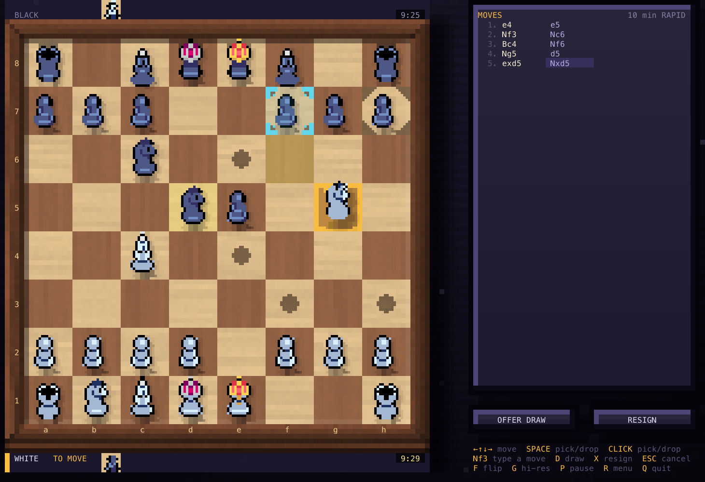

# Terminal Chess

Two-player chess in the terminal, peer to peer. Both players' programs check
every move themselves; a small server only introduces them and never sees the
game. Written in Rust, with pixel-art pieces, chess clocks and a retro look.



> **Status:** a hobby project; v0.1.0 is out. Offline play is complete.
> Online play is built and tested on one machine, but has not yet been played
> between two machines on different networks, and there is no public server
> yet (see [Playing online](#playing-online)).

## Contents

- [Install](#install)
- [Play](#play)
- [Playing online](#playing-online)
- [Fair play online](#fair-play-online)
- [How it works](#how-it-works)
- [Development](#development)
- [Credits](#credits)

## Install

### One command

```sh
curl -fsSL https://chess.thesudhanshu.dev/install.sh | sh
```

It runs on Linux (x86_64 and aarch64, any distribution: the binaries are
static) and macOS (Intel and Apple silicon). What it does:

- Detects the OS and CPU with `uname` (and spots a shell running under
  Rosetta on Apple silicon).
- Downloads `SHA256SUMS` and checks its ed25519 signature against the release
  key written into the script, using `ssh-keygen -Y verify` (OpenSSH 8.1 or
  newer, already on macOS and most Linux systems). Then it checks the
  archive's SHA-256 against that signed list. Anything that fails is refused.
  HTTPS protects the script itself; the signature protects the download.
- Installs `chess-tui` to `~/.local/bin` (no sudo) and tells you if that
  folder is not on your `PATH`. Running it again updates.

Settings: `CHESS_VERSION=v0.1.0` installs a given release,
`CHESS_INSTALL_DIR` picks another folder. For example:

```sh
curl -fsSL https://chess.thesudhanshu.dev/install.sh | CHESS_VERSION=v0.1.0 sh
```

Each release archive also holds `chess-rendezvous` and `chess-relay`, for
running your own servers. Still to come: public servers built in as the
default, so online play works with no setup; later maybe a Homebrew tap.

**Making a release** (maintainers): set the `chess-tui` version in its
`Cargo.toml`, then push a matching tag (`git tag v0.1.0 && git push origin
v0.1.0`). `.github/workflows/release.yml` tests, builds the four archives
with `scripts/package.sh`, signs `SHA256SUMS` with the `RELEASE_SIGNING_KEY`
secret, installs from the result with `install.sh` as a check, and publishes
a GitHub release with `install.sh` attached. `scripts/package.sh TARGET`
also builds an archive locally (a Mac can build the Linux ones too).
`chess.thesudhanshu.dev` (GitHub Pages: `site/index.html` and `install.sh`)
is redeployed by `.github/workflows/pages.yml` whenever either changes on
`main`, without a release.

### Build from source

You need [Rust](https://rustup.rs) (stable) on macOS or Linux. Windows is
untested.

```sh
git clone https://github.com/sudhanshu19102003/chess.git
cd chess
cargo install --path crates/chess-tui     # installs `chess-tui` into ~/.cargo/bin
chess-tui
```

To run your own servers for online play, also install them:

```sh
cargo install --path crates/chess-net     # chess-rendezvous, chess-relay, chess-punch
```

Or run without installing: `cargo run --release -p chess-tui`.

## Play

Make the terminal window about **146 × 50 cells**. The game is drawn at one
size; if the window is too small it asks you to zoom out, and if it is much
bigger it asks you to zoom in (Enter plays anyway).

The home screen offers **OFFLINE** (two players at one keyboard), **PEER TO
PEER**, and **VS COMPUTER** (not built yet). Pick a time control, press Enter,
and the game starts after a 3-2-1 countdown.

| Keys | |
|---|---|
| arrows or `hjkl` | move the cursor |
| Enter or Space | pick up a piece, drop it, confirm a promotion |
| Esc | let go, cancel |
| `Nf3`, `e4`, `O-O`… | type a move (start with a capital letter or `O`) |
| mouse | click or drag pieces, click buttons |
| `d` | offer a draw, or accept the other player's |
| `x` twice | resign |
| `f` | flip the board |
| `a` | auto flip on or off (offline; on by default: after each move the board turns to the side to move) |
| `g` | high-resolution pieces on or off |
| `p` | pause the clock (offline only) |
| `r` | back to the home screen (twice in an unfinished online game) |
| `q` | quit |

All the rules are in: castling, en passant, promotion, check, checkmate,
stalemate, threefold repetition, the 50-move rule and insufficient material.
Repetition and the 50-move rule end the game automatically.

**Pieces and colours.** In terminals that draw Unicode 16 "octant"
characters, such as Ghostty, the pieces are drawn at full resolution. Elsewhere
they are drawn smaller, by hand, in the same palette. `CHESS_PIXELS=octant|half`
overrides the detection, and `g` switches in game. Colours are 24-bit when the
terminal says it supports them (`COLORTERM=truecolor`), otherwise 256-colour;
`CHESS_COLORS=256|truecolor` overrides.

## Playing online

An online game needs two small servers:

- **`chess-rendezvous`** pairs the two players by the number at the start of
  the game code. It never sees the rest of the code, and it never sees a move.
- **`chess-relay`** passes encrypted bytes between the players when they can't
  connect directly. It cannot read or change them.

`chess-tui` uses the public ones at `play.chess.thesudhanshu.dev` (a small
Google Cloud machine; being set up, not live yet). To use other servers, pass
`--server HOST[:PORT]` or set `CHESS_RENDEZVOUS`. The relay defaults to the
same host on port 443; `--relay HOST[:PORT]` or `CHESS_RELAY` if it lives
elsewhere.

### Try it on one machine

```sh
cargo run --release -p chess-net --bin chess-rendezvous          # terminal 1
cargo run --release -p chess-net --bin chess-relay -- --port 4443 # terminal 2
export CHESS_RENDEZVOUS=127.0.0.1 CHESS_RELAY=127.0.0.1:4443     # terminals 3 and 4
cargo run --release -p chess-tui                                  # terminal 3: host
cargo run --release -p chess-tui                                  # terminal 4: join
```

### Run your own servers

Any Linux machine with systemd and a public IPv4 address will do, such as a
small VPS. Open TCP ports 7777 and 7778 (the NAT probe) in its firewall, and
443 if it runs the relay. Copy a release archive (or one from
`scripts/package.sh`) and `deploy/setup.sh` to it, and run:

```sh
sudo sh setup.sh chess-x86_64-unknown-linux-musl.tar.gz            # rendezvous only
sudo sh setup.sh --relay chess-x86_64-unknown-linux-musl.tar.gz    # and the relay
```

That installs the servers as services that start on boot, run without
privileges, and restart if they fail; running it again with a newer archive
upgrades them. The relay runs only with `--relay`: a run without it stops
and disables a relay set up earlier. With no relay, players whose direct
connection fails cannot play. `sudo chess-rendezvous stats /var/lib/chess/results.log` shows
how often players connected directly. For a Google Cloud VM,
`deploy/deploy.sh [--relay] VM_NAME [ZONE]` builds the archive and does all of this
through `gcloud`. Then point the players at it with `--server`.

### Play between two machines

1. **Host:** choose PEER TO PEER → HOST A GAME and a time control. You get a
   code like `7-comet-pilot`, already copied to your clipboard (`c` copies it
   again). Send it to your friend.

2. **Join:** choose PEER TO PEER → JOIN WITH A CODE and type the code.

3. The programs try to connect directly for up to 20 seconds, then fall back
   to the relay. Colours are decided by a fair coin flip that neither side can
   steer. On macOS, allow incoming connections if the firewall asks.

If the direct connection keeps failing, `--force-relay` on both sides skips
it.

## Fair play online

Neither player's program trusts the other, and there is no referee.

- **Every move is checked** by both programs: it must be legal, signed by the
  right player, and lead to the same position on both sides.
- **The clocks are agreed.** Each move carries the time the player says they
  spent on it. Both programs work out the clocks from these figures, so time
  lost on the network never counts against anyone.
- **Lag is checked.** Your program measures how long each of the opponent's
  moves really took to arrive. Some extra time is allowed for network delay,
  as a lag allowance that builds up with each move (the same idea Lichess
  uses). At 10 minutes it starts at 6 s and is capped at 14 s.
- **The game is drawn if the other player's program misbehaves:** the first
  message that fails a check, or a move that arrives later than its stated
  time by more than the lag allowance left. Your program hangs up and goes back
  to the home screen, which says why. A move that ends the game on the board
  keeps its result.
- **Running out of time:** an honest program concedes on its own when its
  clock runs out. If the opponent goes silent past their time and their lag
  allowance, you win on time on your screen.
- **No result:** leaving with `r` twice, losing the connection, or the two
  programs disagreeing about the position (a bug) ends the game with no
  result.

**Limits.** Without a referee, some things can't be prevented: engine
assistance, a player shaving a little off their stated thinking time (up to
the lag allowance), and a losing player quitting or sending a bad message to
end the game early. A finished game's signed move log can be checked by
anyone, but timing and disconnects are only seen by the two players.

## How it works

The workspace has four crates:

| Crate | What it does |
|---|---|
| `crates/chess-core` | The rules: board, legal moves, FEN, SAN, game endings. Tested with perft counts and against [`shakmaty`](https://crates.io/crates/shakmaty) at every move of random games. |
| `crates/chess-verify` | The move protocol: a strict binary message format, signatures (ed25519), the SHA-256 hash chain, the checks every message passes, and the agreed clock. |
| `crates/chess-net` | Getting connected: the rendezvous server, TCP hole punching, the relay, and the handshake (SPAKE2 from the game code, then a Noise session). |
| `crates/chess-tui` | The game you see: the home screen, lobby, board, clocks and the network task. |

How a game is set up:

1. The host asks the rendezvous server for a code. The server only knows the
   number; the two words are a password only the players know.
2. Both programs connect to each other directly if they can, or through the
   relay.
3. They prove they know the same code with SPAKE2, then open an encrypted
   Noise session keyed from it. A server that tried to sit in the middle
   would fail this step.
4. Each side makes a fresh signing key, they agree the time control, and they
   flip a coin for colours (each commits to a random number before revealing
   it).
5. Every move after that is signed and chained to the previous one, and both
   programs check it before playing it.

Both programs must run the same rules engine version; they refuse to play
otherwise.

## Development

```sh
cargo test -p chess-core -p chess-verify -p chess-net
cargo test -p chess-tui --lib --bins --tests          # examples/queens.rs is broken; skip it
cargo test --release -p chess-core -- --ignored       # deep perft runs
cargo clippy --workspace --lib --bins --tests
```

To see the screen without a terminal, render a PNG (uses macOS fonts):

```sh
cargo run --release --example snapshot -- 146 50 out.png midgame
```

Scenes include `home`, `countdown`, `start`, `midgame`, `captures`, `check`,
`mate`, `promotion`, `lobby`, `code`, `connecting`, `failed`, `online`,
`dropped` and `drawn`. Set `CHESS_PIXELS=octant` for high-resolution pieces.

`crates/chess-verify/fuzz` holds a fuzzer for the message parser (nightly
Rust and `cargo install cargo-fuzz`). `crates/chess-net/README.md` describes
the field test for measuring how often direct connections succeed.

Bump `chess_core::ENGINE_VERSION` with any change to legality, game endings,
FEN or SAN.

## Credits

A big shout-out to the [**Pixel Art Chess Set**](https://hollowsmilegames.itch.io/pixel-art-chess-set)
on itch.io ("Chess Asset 16bit pixel art" by Graciano Choc, gchoc). Every
piece on the board comes from it, and it is generously released to the
public domain (CC0). The sprite sheet and its notes are in
[`assets/pieces/`](assets/pieces/).

The lag allowance follows the design of [Lichess](https://lichess.org)'s open
source lag compensation in [scalachess](https://github.com/lichess-org/scalachess).
Game codes follow the idea behind [Magic Wormhole](https://github.com/magic-wormhole/magic-wormhole).
Built with [ratatui](https://ratatui.rs), [tokio](https://tokio.rs),
[snow](https://github.com/mcginty/snow), [spake2](https://crates.io/crates/spake2)
and [ed25519-dalek](https://crates.io/crates/ed25519-dalek).

## License

No license has been chosen yet, so all rights are reserved for now. The piece
art in `assets/pieces/` is CC0 and free for anyone to use.
